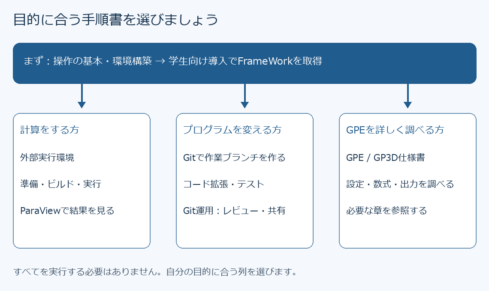
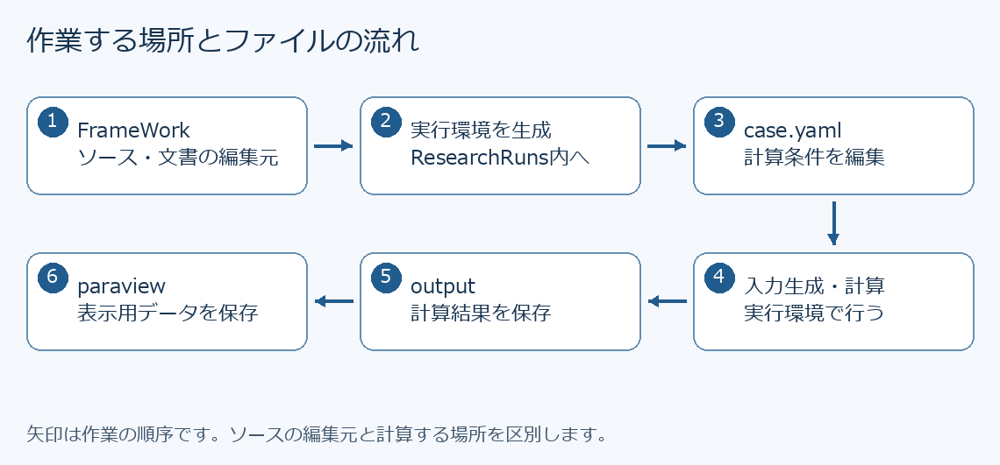

# はじめてのFrameWork：読む順番とパソコン操作

更新日：2026-11-09

FrameWorkは、研究用の計算プログラムと、その準備・実行を助ける道具をまとめたものです。
まずこのページで操作方法を確認し、その後、目的に合う手順書へ進んでください。
すべての手順書のコマンドを順番に実行する必要はありません。

## 1. どこから読めばよいか



図の矢印は読む順番です。計算だけを行う方は、コード拡張やGitの管理者向け操作を行う必要はありません。

| 手順書 | 読む目的・最初の到達点 |
|---|---|
| [PC別 開発環境の構築・ソフトウェア導入](開発環境_構築・ソフトウェア導入手順書.md) | 必要なソフトの役割を理解し、自分のPCへ導入・動作確認する |
| [学生向け導入・Git開発](学生向け_FrameWork導入・Git開発手順書.md) | 取得方法を一つ選び、PC内にFrameWorkを用意する |
| [外部実行環境の生成・ビルド・実行](外部実行環境_生成・ビルド・実行手順書.md) | 自分のOSの手順で、小さな確認用計算を完了する |
| [ParaView可視化](後処理_ParaView可視化手順書.md) | 計算結果を変換し、密度などの色付きの図を表示する |
| [コード拡張](コード拡張_開発手順書.md) | プログラムを変更する場所と確認方法を決める |
| [Git運用](GIT運用マニュアル.md) | チームの共有ルールを確認する。管理者向け操作も含む |
| [GPE/GP3D仕様書](GPE_GP3Dコード全体仕様書.md) | GPEの設定・数式・実装を調べる。操作入門の後に参照する |

図は画像として埋め込んでいます。MarkdownのプレビューまたはGitHubのファイル表示で読めます。
図が見えない場合は、このフォルダ内の`images`にあるPNG画像を開いてください。図の要点は本文でも説明しています。
`docs/office`のWord版は保管資料です。今回の説明・図はこのフォルダのMarkdown（`.md`）版で確認してください。

## 2. 最初に確認しておくこと

初回は、担当教員・計算機管理者から次の情報を受け取ります。
「分からないから例の値を使う」と、別の計算機向けの設定で動かしてしまうことがあります。

| 確認するもの | 記録する例 |
|---|---|
| 作業するPCとOS | 自分のWindows PC／研究室のLinux PC／スパコン |
| 計算の種類 | NSEまたはGPE、使用するサンプル条件 |
| 使用するソースの版 | 指定されたタグ名またはコミットID |
| FrameWorkの保存場所 | `C:\Research\FrameWork`（説明用の例） |
| 結果の保存場所 | 自分のホームフォルダ内の`ResearchRuns`など |
| ソフトの準備状況 | Git、Python、コンパイラ等が使える端末と起動方法 |

ソフトがまだ準備されていない方は、[PC別の環境構築手順書](開発環境_構築・ソフトウェア導入手順書.md)へ進みます。
Windows・Linux・スパコンについて、必要なソフトの役割、導入順、確認方法を説明しています。

Gitはファイルの履歴を管理する道具、GitHubはその履歴をインターネット上で共有するサービスです。
Gitを入れただけでは計算はできません。計算用ソフトの組合せは実行手順書の前提条件で確認します。

## 3. ファイル、フォルダ、パスとは

- **ファイル**：文章や計算条件などを保存した一つのデータです。例：`case.yaml`。
- **フォルダ（ディレクトリ）**：ファイルを入れる場所です。
- **パス**：ファイルやフォルダの住所です。`C:\Research\FrameWork`はWindowsの住所の例です。
- **ルート／直下**：ここでは指定されたフォルダそのものを指します。「FrameWork直下」は`SolverLibrary`の中ではありません。
- **拡張子**：ファイル名の末尾です。`.md`は説明文、`.yaml`は設定、`.py`はPythonのプログラムです。

Windowsでは`Windows`キーを押しながら`E`を押すと、ファイルを探す「エクスプローラー」が開きます。
上部のアドレス欄へフォルダのパスを貼り付け、`Enter`を押すと移動できます。
`case.yaml.txt`のような保存間違いを見分けるため、エクスプローラーの表示設定で「ファイル名拡張子」を表示します。
Linuxではファイルマネージャーで同様にフォルダを開けます。

| 表記 | 読み方 |
|---|---|
| `C:\Research\FrameWork` | Windowsの絶対パス。現在位置によらず場所が決まる |
| `./tools/run_case.py`、`.\tools\run_case.py` | 今いるフォルダから`tools`の中へ進む相対パス |
| `..` | 一つ上のフォルダ |
| `$env:USERPROFILE` | PowerShellで自分のホームフォルダに置き換わる表記 |
| `$HOME`、`~` | bashで自分のホームフォルダを表す表記 |
| `<case_id>`、`YOUR_GITHUB_ID`、`NNNN` | 自分の値に置き換える説明用の文字。そのまま入力しない |

`Owner`や`case0012`は特定の利用者・計算の例です。自分の保存場所や生成ログの番号を使います。
Linuxでは`Research`と`research`は別フォルダです。空白を含むパスは半角の`"`で囲みます。

## 4. コマンドを入力する画面を開く

**端末（ターミナル）**は、文字でPCに操作を依頼する画面です。そこへ入力する一つの指示を**コマンド**と呼びます。
ブラウザの検索欄やPythonの`>>>`画面には入力しません。

### Windowsの場合

1. スタートメニューを開き、`PowerShell`を検索します。
2. Windows PowerShellまたはPowerShellを通常起動します。ここでの基本操作に管理者起動は不要です。
3. `PS C:\...>`のような文字の後ろにカーソルがあれば入力できます。
4. 次を1行入力し、`Enter`を押します。

```powershell
Get-Location
```

現在のフォルダが表示されれば成功です。FrameWorkを`C:\Research\FrameWork`に取得した後は、次で移動・確認します。

```powershell
Set-Location "C:\Research\FrameWork"
Get-ChildItem
```

### Linuxの場合

アプリ一覧から「端末」または「Terminal」を開きます。施設指定の接続方法がある場合はそちらに従います。
スパコンへ接続した端末では、そのスパコン上のファイルを操作します。

```bash
pwd
```

現在のフォルダが表示されれば成功です。取得済みFrameWorkへ移動する例は次のとおりです。

```bash
cd "$HOME/Research/FrameWork"
ls
```

どちらのOSでも一覧に`ScriptLibrary`と`SolverLibrary`が見えれば、FrameWork直下にいます。
移動に失敗したら、その後のコマンドを続けず、保存場所を確認してください。

## 5. コマンドのコピーと結果の読み方

1. 自分のOSに合う欄だけを使います。Windows欄とLinux欄は同じ操作の別表記です。
2. まず説明を読み、例のユーザー名・パスを自分の値へ置き換えます。
3. 通常の1行コマンドは1行ずつコピーします。Windowsでは`Ctrl+V`、Linuxの端末では通常`Ctrl+Shift+V`で貼り付けます。
4. 内容を確認して`Enter`を押します。貼り付け時に実行される場合もあるため、無関係な行まで選択しません。
5. 入力待ちの表示が戻り、結果を確認できたら次へ進みます。エラーが出たらそこで止めます。

コード欄の`powershell`、`bash`、囲みの記号、`PS C:\...>`、説明用の出力は入力しません。
`yaml`の欄は**ファイルへ書く設定**、`text`の欄は主に**構成図や表示例**です。
ただし「両OS共通のコマンド」と明記された欄は実行する指示です。

PowerShellの行末のバッククォート（`` ` ``）、bashの行末の`\`は「次の行へ続く」という意味です。
この場合は続きの行まで一つのコマンドとして貼り付けます。末尾の記号の後ろへ空白を足さないでください。
迷う場合は改行と行末の継続記号を取り除き、各行の間に半角空白を入れて1行にします。

| 表示 | 意味と次の操作 |
|---|---|
| `True`／`OK` | その確認項目が見つかった・成功した。何を確認した結果かを読む |
| `False`／`not found` | 対象が見つからない。現在位置・名前・導入状況を確認する |
| `Error`／`Traceback`／`FAILED` | 失敗した。次へ進まず、コマンドとメッセージを保存する |
| `>>`（PowerShell） | 引用符や複数行入力がまだ閉じていない可能性。意図しない場合は`Ctrl+C`で入力を取り消す |
| 一覧が画面いっぱいに表示される | `git diff`や`less`の閲覧中なら`q`で戻る |

ビルドや計算は表示が止まっていても処理中のことがあります。同じコマンドを重ねて実行しません。
`Ctrl+C`は実行中の処理を中断することがあります。計算中に使う場合、途中の出力が未完成になり得ます。

## 6. 設定ファイルを開いて保存する

1. エクスプローラー等で編集対象のフォルダへ移動します。
2. 対象ファイルを右クリックし、「プログラムから開く」等で研究室指定のテキストエディターを選びます。Wordは使いません。
3. 作業前にファイルを別名でコピーしておくと、設定の変更前後を比較できます。既存のバックアップへ上書きしない名前を付けます。
4. 指定された項目だけを変更し、`Ctrl+S`で保存します。ファイル名・拡張子を変えず、文字コードはUTF-8を使います。
5. エディター上部の保存先を確認してから、手順書の検証コマンドへ進みます。

YAMLは行頭の空白で親子関係を表します。`Tab`キーではなく半角空白を使い、同じ階層の字下げをそろえます。
次は書き方の説明例です。新しい設定ファイル全体として貼り付ける例ではありません。

```yaml
parallel:
  use_mpi: true
  use_cuda: false
```

この例では`parallel`の下に二つの設定があります。`true`は有効、`false`は無効です。
同じファイルに既に`parallel:`があればその中を編集し、同名のまとまりを末尾に追加しません。
全角の空白・コロン・引用符は使いません。小数点は`.`、数値に桁区切りの`,`は付けません。

## 7. 作業場所を区別する



FrameWorkと実行環境には似た名前のフォルダがあります。**FrameWorkの取得後も、実行環境は別途生成します。**
生成後の実行環境では`environment.lock.json`と`tools/run_case.py`が目印です。
プログラムの修正はFrameWork、計算条件の修正は対象実行環境内の`case.yaml`で行います。

| 用語 | この手順書での意味 |
|---|---|
| ソース | 人が読んで編集するプログラム |
| ソルバー | 方程式を解く計算プログラム。ここではNSEやGPE |
| ビルド | ソースを、PCが実行できる形に変換すること |
| コンパイラ | ビルドでソースを翻訳する道具 |
| ケース（case） | 計算条件一式。番号が違えば別の計算として扱う |
| プロファイル | CPU・GPUや依存ライブラリなど、ビルドの組合せ |
| CPU／GPU | 計算を担当する装置。GPUを使うには対応環境が必要 |
| MPI／OpenMP | 計算を複数の処理へ分担させる仕組み |
| ログ | 実行時のメッセージを記録したもの |
| 後処理 | 計算結果を画像や統計などに変換する作業 |

## 8. 困ったときは

エラーが出た段階で止まり、次の内容をメモして担当者へ相談します。
エラーの英語をすべて理解する必要はありません。最後の1行だけでなく、その前の説明も残します。

```text
使ったPC・OS：
見ていた手順書の名前と章：
現在のフォルダ（Get-Locationまたはpwdの結果）：
実行したコマンド：
表示されたメッセージ：
期待した結果と実際の結果：
```

端末の文字を選択してコピーし、メモへ貼り付けます。コピーできなければ画面のスクリーンショットでも構いません。
パスワード・トークン・秘密鍵は送らないでください。失敗したからといって、フォルダの削除、
`--overwrite`、Gitの強制操作を試す必要はありません。
