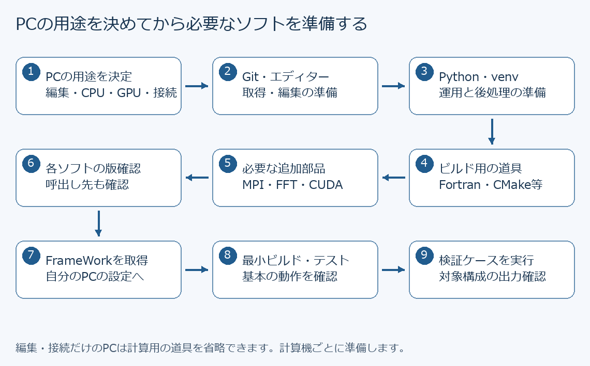

# PC別 開発環境の構築・ソフトウェア導入手順書

更新日：2026-11-09

この手順書は、FrameWorkを使うために「どのPCに、何を、何のために入れるか」を説明します。
パソコン操作に不慣れな方は、先に[操作の基本](README.md)の第3〜6節を読んでください。
ここでソフトを準備した後、[学生向け導入手順書](学生向け_FrameWork導入・Git開発手順書.md)でFrameWorkを取得し、
[実行手順書](外部実行環境_生成・ビルド・実行手順書.md)で計算用のフォルダを作ります。

本書のコマンドは導入方法の説明です。本書の追加によって利用中のPCへソフトが自動インストールされることはありません。
記載した構成はリポジトリの機械設定に合わせたものです。すべてのPCで導入・動作試験を完了したという意味ではなく、最後の確認試験を各PCで行います。

## 1. 自分のPCに必要な範囲を選ぶ

計算は、手元のPCでも、研究室の別の計算機でも実行できます。**ソフトは、実際にその作業を行うPCへ入れます。**
手元のPCへコンパイラを入れても、接続先のサーバーに入ったことにはなりません。

| PCの用途 | 準備するもの | 読む章 |
|---|---|---|
| Windowsで編集・取得・結果表示をする | エディター、Git、必要ならPython・ParaView・接続ツール | 第3章、第8章 |
| WindowsでCPU計算をする | 上記＋GNU Fortran、CMake、Ninja、計算方式に応じたMPI・FFTW | 第3〜4章 |
| WindowsでNVIDIA GPU計算をする | CPU開発の基本一式＋GPUドライバ、CUDA Toolkit、Visual Studio Build Tools | 第3〜5章 |
| Linuxの自分のPCでCPU/GPU計算をする | Linux用のPython・ビルド道具・MPI、必要なFFT/GPUライブラリ | 第6章 |
| 研究室サーバー・スパコンで計算する | 施設が用意したコンパイラ等を読み込む。接続するPCも準備する | 第7〜8章 |
| MacまたはWindows ARM PCから接続する | 編集・接続・表示用アプリ。計算は確認済みLinux等で行う | 第8章 |

本書のWindows計算手順は**Intel/AMDの64ビット（x64）Windows**向けです。
Windowsの「設定」→「システム」→「バージョン情報」で「システムの種類」を確認します。
ARM版Windowsへx64の構成をそのまま適用しません。リポジトリにはmacOS専用の標準機械設定はありません。
WSL（Windows上のLinux）を使う場合は別のLinux環境として扱い、Windows用のMS-MPIやビルド済みファイルと混ぜません。
本書では初回にWindowsネイティブとWSLの両方を構築する必要はありません。



図は準備の順番です。GPU計算をしない方はGPU用の追加ソフトを省略します。
最初に次の情報をメモします。研究室共有PCでは、既にある環境と担当者の指定を優先してください。

```text
PC名・OS・CPUの種類：
用途（編集だけ／CPU計算／GPU計算／遠隔接続）：
使用モデル（NSE／GPE／その他）：
GPUの機種（使う場合）：
管理者・相談先：
使用するソフトの指定版：
FrameWorkの保存先：
計算結果の保存先：
```

## 2. ソフトの役割を理解する

### 2.1 基本のソフト

「推奨」は別の同等ソフトでもよい項目、「必要」はその作業に欠かせない項目です。

| ソフト・機能 | 役割を平易に言うと | 必要になる作業 |
|---|---|---|
| ブラウザ | 手順書・GitHub・ダウンロードページを開く | 導入・情報確認。普段のブラウザでよい |
| PowerShell／bash | 文字でPCに指示を出す | コマンド実行。WindowsはPowerShell、Linuxはbashを基本とする |
| VS Codeなどのテキストエディター | ソースや設定を開き、編集・保存する | 編集に推奨。**エディターだけでは計算プログラムをビルドできない** |
| Git | 変更履歴をPC内で記録し、他のPCと受け渡す | FrameWorkの取得・更新・開発 |
| GitHub | インターネット上でソースやレビューを共有するサービス | ブラウザで利用。Gitとは別物で、GitHubアプリの導入は必須ではない |
| Python | ケース生成・検証・実行制御の`.py`を動かす | このフレームワークの運用・後処理 |
| venv | プロジェクト用のPythonの道具箱を分ける | Pythonに標準付属。OSや別用途のPythonと追加パッケージを分離する |
| pip | Pythonの追加部品をインストールする | `python -m pip`で使う。単独の計算ソフトではない |
| PyYAML | YAML設定をPythonで読む | 推奨。フレームワークには簡易読込みの代替もあるが、本書では導入する |
| NumPy | 多数の数値を配列として処理する | SLF変換などの後処理で必要 |
| ParaView | 計算結果を色・断面・等値面で表示する | 結果を図で見るPCに必要。ソルバーの代わりにはならない |

### 2.2 計算プログラムを作る道具

| ソフト | 役割 | 必要になる構成 |
|---|---|---|
| GNU Fortran（`gfortran`） | Fortranソースを実行できる形へ翻訳するコンパイラ | 本書のCPU/GPUビルド。GPU版にもFortran部分がある |
| GCC／G++ | C／C++ソースを翻訳するコンパイラ | 関連ライブラリやLinuxのCUDAビルド等 |
| CMake | ソース、コンパイラ、ライブラリの組合せからビルド手順を作る | NSE/GPEのビルド |
| Ninja | CMakeが作った手順に従い、必要なコンパイルを実行する | 標準機械設定のビルド方式 |
| CTest | 用意されたテストを実行し、成功・失敗を集計する | CMakeに付属。検証に使う |
| MSYS2 UCRT64 | Windows用GNUコンパイラやライブラリをまとめて導入・管理する環境 | 本書のWindowsビルド。`pacman`はそのインストール道具 |

OpenMPはCPU内で処理を分担する仕組みです。本書のGNUコンパイラに必要な対応が含まれるため、
「OpenMP」という独立アプリを探してインストールする手順はありません。

### 2.3 計算方式に応じて追加する部品

| ソフト | 役割 | 必要な場合 |
|---|---|---|
| Microsoft MPI（MS-MPI） | Windowsで複数の計算プロセスを起動し、データを交換する | WindowsのMPI計算 |
| MS-MPI Runtime | ビルド済みMPIプログラムを動かす部品 | MPI実行。`mpiexec`等を含む |
| MS-MPI SDK | MPIを使うプログラムを作るための宣言・ライブラリ | MPIビルド。**Runtimeだけでは不足** |
| Open MPIなど | Linux側のMPI実装 | LinuxのMPI計算。施設で指定された実装を一つ使う |
| FFTW | CPUで高速なフーリエ変換を行うライブラリ | GPEの通常CPU構成やNSEのFFT利用機能 |
| 2DECOMP&FFT | 大きな配列をMPIで分割してFFTを計算する部品 | GPEのCPUペンシルFFT、NSEの分散FFT初期化・forcing等 |
| NVIDIAドライバ | OSがNVIDIA GPUを使うための基本部品 | NVIDIA GPU利用 |
| CUDA Toolkit | NVIDIA GPU用のプログラムを作る開発道具。`nvcc`等を含む | CUDA版のビルド。**ドライバだけでは不足** |
| Visual Studio Build Tools | WindowsのC++ビルド道具（MSVCとWindows SDK等） | Windows CUDA版。VS Codeとは別製品 |
| cuFFT | 単一GPUでFFTを行うライブラリ | GPUのFFT計算。CUDA Toolkit側の部品 |
| NVIDIA HPC SDK／cuFFTMp／NVSHMEM | 対応した複数GPUの分散FFT・通信を行う一式 | LinuxのcuFFTMp構成。単一GPUを始めるためには不要 |

Runtimeは「動かす部品」、SDKや`-dev`パッケージは「作るための部品」です。
計算利用者もソースからビルドする運用なら、作るための部品が必要です。
ライブラリは通常スタートメニューから開くアプリではなく、プログラムから呼び出されます。

## 3. Windows：編集・Python・結果表示を準備する

### 3.1 ダウンロードとインストールの基本

1. 本書に記載した公式ページをブラウザで開きます。
2. 使用PCのOS・CPUに合うインストーラーを選び、ダウンロードします。
3. エクスプローラーの「ダウンロード」から取得したファイルを開きます。ダウンロードしただけでは導入は終わりません。
4. インストーラーの案内に従います。共有PCの管理者権限が必要なら、そのPCの管理者に導入を依頼します。
5. 完了後、PowerShellやVS Codeを開き直し、確認コマンドを実行します。

既に入っているソフトは先に版と保存先を確認し、同じものを別の場所へ重ねて導入しません。

### 3.2 GitとVS Code

Gitは[Git for Windowsの公式配布](https://git-scm.com/install/windows)からx64版を取得します。
セットアップでコマンドラインからGitを利用できる選択肢を選びます。完了後、通常のPowerShellで確認します。

```powershell
git --version
Get-Command git
```

バージョンとプログラムの場所が表示されれば、Gitを呼び出せています。
Gitの名前・メールアドレス・GitHub認証は[学生向け手順書](学生向け_FrameWork導入・Git開発手順書.md)で設定します。

エディターは[VS CodeのWindows導入案内](https://code.visualstudio.com/docs/setup/windows)からインストールできます。
起動して`File > Open Folder`（ファイル→フォルダーを開く）で取得したFrameWorkを選びます。
ファイルを左側の一覧から選び、編集後は`Ctrl+S`で保存します。Markdownはプレビューで読むと図も表示されます。
Python・Fortran・CMake向け拡張機能は必要になってから追加できますが、拡張機能を入れてもコンパイラ本体は導入されません。

### 3.3 Pythonを導入する

[Python公式のWindows案内](https://docs.python.org/3/using/windows.html)に従います。
Python Install Managerを使う場合は、管理ツールと実際に動かすPython本体の両方を用意します。
研究室で指定されたPython 3の版を使ってください。指定がない場合の導入例として3.12系を示します。
これは全機能の対応保証や最新推奨版の指定ではありません。

**Python Install Managerを新規導入した場合だけ**、PowerShellで次を実行できます。

```powershell
py install 3.12
py -3.12 --version
```

旧Python Launcherの`py`には`install`コマンドがありません。その場合は既存Pythonを確認するか、公式案内の導入方法に従います。
既に使えるPythonがある方は、新しい版の追加を省略できます。

```powershell
python --version
python -c "import sys; print(sys.executable)"
```

Python 3の版と実行ファイルの場所を記録します。ストアが開く、または「認識されません」と出る場合は、Python本体を呼べていません。
`py -3.12`だけが使える場合は、次の仮想環境作成コマンドの先頭の`python`を`py -3.12`へ変更してください。

### 3.4 FrameWork用のPython環境を作る

追加部品を他の用途と分けるため、ホームフォルダ内の`ResearchTools`に仮想環境を作ります。
以下の作成操作は初回だけです。同じフォルダに既存環境がある場合は再作成せず、その環境を確認します。

```powershell
New-Item -ItemType Directory -Force "$env:USERPROFILE\ResearchTools"
python -m venv "$env:USERPROFILE\ResearchTools\framework-python"
& "$env:USERPROFILE\ResearchTools\framework-python\Scripts\python.exe" -m pip install pyyaml numpy
```

引用符付きの実行ファイルのパスを実行するため、先頭に`&`を付けています。
`venv`はPythonの追加部品を分離する標準機能です。[Python公式venv説明](https://docs.python.org/3/library/venv.html)

作業するPowerShellを開くたびに、次を実行します。

```powershell
$env:Path = "$env:USERPROFILE\ResearchTools\framework-python\Scripts;" + $env:Path
python -c "import sys, yaml, numpy; print(sys.executable); print('Python packages: OK')"
```

表示されたパスに`ResearchTools\framework-python`が含まれ、`Python packages: OK`と出れば成功です。
これにより、既存手順書の`python`コマンドがこの環境を使います。変更は今のPowerShell内だけで、閉じると元に戻ります。
`Activate.ps1`の実行ポリシーを変更しなくても、この方法で作業できます。

### 3.5 ParaViewを導入する

[ParaView公式ダウンロード](https://www.paraview.org/download/)からWindows用の配布版を選び、案内に従って導入します。
スタートメニューから起動して画面が開けば、アプリの起動確認は完了です。
実データの読込み確認は計算後に[可視化手順書](後処理_ParaView可視化手順書.md)で行います。
ParaView内部のPythonと、第3.4節のPythonは別の環境です。通常のSLF変換はPowerShellの`python`で行います。

## 4. Windows：CPU計算用の道具を追加する

### 4.1 MSYS2 UCRT64を導入する

[MSYS2公式案内](https://www.msys2.org/)からx64版を導入します。本書は標準の保存先`C:\msys64`を使用します。
別の保存先を選んだ場合は、以下のパスと第9章の機械設定を同じ場所にそろえます。

1. インストール後、スタートメニューから**MSYS2 UCRT64**を開きます。
2. 次を実行して更新します。ここはPowerShellではなくMSYS2の画面です。

```bash
pacman -Syu
```

更新中に終了・再起動の指示が出たら、それに従ってMSYS2 UCRT64を開き直し、同じコマンドを再実行します。
MSYS2は全体をそろえて更新する方式です。途中の状態でパッケージ導入を続けません。[公式の更新手順](https://www.msys2.org/docs/updating/)

3. 更新が完了したら、同じMSYS2 UCRT64画面で次を実行します。

```bash
pacman -S --needed mingw-w64-ucrt-x86_64-gcc-fortran mingw-w64-ucrt-x86_64-cmake mingw-w64-ucrt-x86_64-ninja mingw-w64-ucrt-x86_64-fftw
```

導入内容と容量を確認し、`Proceed with installation? [Y/n]`なら`Y`を入力して`Enter`を押します。
上の一行でFortranコンパイラ、CMake、Ninja、FFTWと必要な依存部品を導入します。
`ucrt`を含む同じ系列を使い、`/usr/bin`側や別系列のコンパイラと混ぜません。
参考：[UCRT64環境](https://www.msys2.org/docs/environments/)、[Fortranパッケージ](https://packages.msys2.org/packages/mingw-w64-ucrt-x86_64-gcc-fortran?repo=ucrt64)、[FFTWパッケージ](https://packages.msys2.org/packages/mingw-w64-ucrt-x86_64-fftw)、[CMakeの選び方](https://www.msys2.org/docs/cmake/)。

### 4.2 PowerShellから使えるようにする

MSYS2の導入操作を終えたら、FrameWorkの作業は通常のPowerShellへ戻ります。
次は、そのPowerShellで実行ファイルを探す場所（PATH）を追加する操作です。**端末を開くたびに実行します。**

```powershell
$env:Path = "C:\msys64\ucrt64\bin;" + $env:Path
$env:Path = "$env:USERPROFILE\ResearchTools\framework-python\Scripts;" + $env:Path
Get-Command python, gfortran, cmake, ninja
gfortran --version
cmake --version
ninja --version
```

Pythonは仮想環境、GNU Fortran等は`C:\msys64\ucrt64\bin`から呼ばれていることを確認します。
NSEにはCMake 3.24以上、GP3Dには3.20以上が必要です。本書では両方を扱える3.24以上を基準にします。
この最小版は各ソルバーの`CMakeLists.txt`に基づきます。
PATHを通すと、実行時に必要なGNU Fortran・FFTWのDLLも見つけられます。

### 4.3 MPIを使う場合はRuntimeとSDKを入れる

[Microsoft MPI公式案内](https://learn.microsoft.com/en-us/message-passing-interface/microsoft-mpi)から
[公式リリース](https://github.com/microsoft/Microsoft-MPI/releases)へ進み、同じ配布版のRuntimeとSDKを導入します。
配布ファイルは通常`msmpisetup.exe`（Runtime）、`msmpisdk.msi`（SDK）です。インストーラーの案内に従って両方を完了します。

PowerShellを開き直し、第4.2節のPATHを設定してから確認します。

```powershell
Get-Command mpiexec
mpiexec -help
Test-Path 'C:\Program Files (x86)\Microsoft SDKs\MPI\Include\mpif.h'
Test-Path 'C:\Program Files (x86)\Microsoft SDKs\MPI\Lib\x64\msmpi.lib'
```

ヘルプが表示され、ファイル確認が`True`なら標準配置の基本部品が見つかっています。
`mpiexec`が見つからない場合は、Runtimeの導入先を確認します。標準の実行ファイルが存在するなら、そのPowerShellで次を追加できます。

```powershell
$env:Path = 'C:\Program Files\Microsoft MPI\Bin;' + $env:Path
```

MPIを実際に使えるかは第10章のMPI確認でも調べます。複数PCにまたがる通信設定は、単一PC内のMPI起動とは別作業です。
初回からファイアウォール全体を無効にせず、共有計算機の通信設定は管理者の方針に従ってください。

### 4.4 FFTライブラリの範囲

GPEの通常CPU構成はFFTWを使います。第4.1節で導入した場合、`libraries.fftw_root`は`C:/msys64/ucrt64`です。
組込みDFTを使う小さな確認試験ではFFTWなしでも動かせますが、大規模計算の性能確認には使いません。
2DECOMP&FFTが必要な機能を選ぶ場合は、第9.2節で追加準備を行います。

## 5. Windows：NVIDIA GPU計算用の追加準備

### 5.1 先に組合せを決める

必要なのは「NVIDIA GPUの機種」「ドライバ」「CUDA Toolkit」「対応するMSVC」の組合せです。
各ソフトを無条件に最新版へそろえる手順にはしません。使用するToolkitの対応表でOS・GPU・Visual Studioの版を確認します。
[NVIDIA公式Windows導入ガイド](https://docs.nvidia.com/cuda/cuda-installation-guide-microsoft-windows/index.html)

1. Windowsのデバイスマネージャーで「ディスプレイ アダプター」を開き、GPU名を記録します。
2. 研究室で動作確認済みのToolkitとコンパイラの組合せを選びます。
3. 対応するNVIDIAドライバを導入し、要求された場合は再起動します。既存ドライバが対応する場合は入れ直し不要です。
4. [Microsoft公式配布](https://visualstudio.microsoft.com/downloads/)の「Build Tools for Visual Studio」から対応版を導入します。「C++によるデスクトップ開発」と、対応するMSVC x64/x86ビルドツール、Windows SDKを選びます。使用するCUDAが旧版のMSVCを要求する場合は、その対応版の配布案内へ進みます。
5. 対応するCUDA Toolkitを導入します。ビルドにはコンパイラ`nvcc`やヘッダー・ライブラリが必要です。

Visual Studio Build Toolsを入れてもGNU Fortranは置き換わりません。Fortran部分はGNU、CUDA C++側はNVCCとMSVCを使います。
VS Codeは編集画面、Build Toolsはコンパイルする部品です。

### 5.2 確認する

PowerShellを開き直し、第4.2節のPATHを設定します。

```powershell
nvidia-smi
nvcc --version
gfortran --version
```

`nvidia-smi`にGPU名・ドライバ版、`nvcc`にToolkitの版が出ることを確認します。
`nvidia-smi`の`CUDA Version`はドライバ側の対応情報であり、インストール済みToolkitの版と同じとは限りません。
Toolkitは`nvcc --version`で確認します。
MSVCの確認はスタートメニューの「x64 Native Tools Command Prompt」等、対応版の開発者用端末で`cl`を実行します。
入力ファイルを指定していないためビルドはしません。Microsoft C/C++の版が表示されることを確認します。
通常のPowerShellで`cl`が見つからないだけでは未導入とは限りません。

FrameWorkのWindowsビルドは対応する`vcvars64.bat`を利用してC++環境を初期化します。
検出できない場合は、第9章の機械設定とビルドログを担当者に確認してもらいます。
GPUの`cuda_architectures`は実機に合わせます。テンプレートにある`86`を全GPUに使うことはできません。
GPUの動作確認は、小規模な対象ソルバーのビルド・実行で完了させます。

## 6. LinuxのPC：CPU開発環境を構築する

### 6.1 対象とインストール

以下は**Ubuntu 24.04 LTS系・x86_64の自分の管理下のPC**の例です。他のLinuxや施設サーバーにそのまま実行しません。
OSは`cat /etc/os-release`、CPU種別は`uname -m`で確認します。スパコンでは第7章へ進みます。

端末で次を実行します。`sudo`はシステムにソフトを入れるための管理者権限を使う指示です。
パスワード入力中は文字や丸印が表示されないことがあります。入力後に`Enter`を押します。

```bash
sudo apt update
sudo apt install git python3 python3-venv python3-pip build-essential gfortran cmake ninja-build openmpi-bin libopenmpi-dev libfftw3-dev
```

`apt update`は導入候補の一覧を更新し、`apt install`は指定したソフトを入れます。
内容と容量を確認してから続行します。`build-essential`はC/C++等の基本ビルド道具、
`openmpi-bin`はMPI実行用、`libopenmpi-dev`は開発用、`libfftw3-dev`はFFTWの開発用です。
公式パッケージ情報：[GNU Fortran](https://packages.ubuntu.com/noble/gfortran)、
[Open MPI開発用](https://packages.ubuntu.com/noble/libopenmpi-dev)、[FFTW開発用](https://packages.ubuntu.com/noble/libfftw3-dev)。

```bash
git --version
python3 --version
gfortran --version
cmake --version
ninja --version
mpifort --version
mpiexec --version
```

`mpifort`はFortranコンパイラにMPI用の設定を加えて呼び出す窓口です。
コンパイル側のMPIと`mpiexec`が同じ実装・版の一式から選ばれていることを確認します。
`which mpifort`、`which mpiexec`で場所を確認できます。

### 6.2 Pythonの作業環境

初回だけ、端末で次を実行します。

```bash
mkdir -p "$HOME/ResearchTools"
python3 -m venv "$HOME/ResearchTools/framework-python"
"$HOME/ResearchTools/framework-python/bin/python" -m pip install pyyaml numpy
```

作業端末を開くたびに次を実行します。

```bash
source "$HOME/ResearchTools/framework-python/bin/activate"
python3 -c "import sys, yaml, numpy; print(sys.executable); print('Python packages: OK')"
```

表示されたパスが作成した仮想環境内で、`OK`が出れば成功です。
終了時は`deactivate`または端末を閉じることで元に戻ります。
`externally-managed-environment`が出た場合は、OSのPythonへ追加しようとしていないか確認します。
`sudo pip`や`--break-system-packages`で回避せず、この仮想環境を使います。

### 6.3 編集と可視化

VS Codeなどのエディターは、そのLinuxに対応する公式配布版または施設指定のパッケージを使います。
ParaViewは[公式配布](https://www.paraview.org/download/)の対応するLinux版を選び、展開版なら
展開先の`bin/paraview`を起動します。GUIのない計算サーバーでは、手元のPCで表示して構いません。
VTI/PVDの移動方法は第8章を参照してください。

### 6.4 LinuxでGPUを使う場合

CPU開発の基本を確認した後、使用するOS・GPUに対応したドライバとCUDA Toolkitを導入します。
[NVIDIA公式Linux導入ガイド](https://docs.nvidia.com/cuda/cuda-installation-guide-linux/index.html)で、
使用するToolkitの対応OS・GCC版を確認し、その版に記載されたパッケージ導入方法を使います。
配布元の異なるドライバ導入方法を混在させません。
研究室サーバーでは管理者が導入済みの環境を使います。

導入後は`nvidia-smi`、`nvcc --version`を確認し、必要に応じて案内されたCUDAの`bin`・ライブラリ探索パスを設定します。
GNUコンパイラがToolkitの対応範囲外なら、エラーを無視するオプションで進めず、対応版を選びます。
cuFFTMpの複数GPU構成は第9.2節の追加ライブラリとして扱います。

## 7. 研究室サーバー・スパコン：用意された環境を使う

### 7.1 手元のPCと接続先を区別する

接続には、施設が発行したアカウント、接続先名、認証方法、必要ならVPNや踏み台が必要です。
これらは施設の利用手引きで確認します。接続先は本書からは決まりません。

```text
手元のPC：エディター・端末・SSH・ParaView
      ↓ 接続／必要なデータを転送
サーバー：Python・コンパイラ・MPI・CUDA・実行環境
      ↓ スパコンではジョブを投入
計算ノード：割り当てられたCPU/GPUで計算
```

ログインノードは接続・準備用、計算ノードは計算用です。大規模なビルド・計算を行ってよい場所は施設規則に従います。

### 7.2 moduleで環境を選ぶ

`module`は、施設が用意したソフトの版と検索パスを選ぶ仕組みです。通常、ソフトそのものを新しくインストールしません。

```bash
module avail
module list
```

`avail`は利用可能な候補、`list`は現在選択中のものです。次は施設がこの名前を提供している場合だけの例です。

```bash
module load gcc
module load openmpi
module load cmake
module load fftw
```

Python・Ninjaも必要です。対応するmodule名と組合せを利用手引きで確認します。
GPU利用時はCUDA等のmoduleも追加します。初回は担当者から、動作確認済みの`module load`行一式を受け取ると確実です。
異なるMPI・コンパイラのmoduleを重ねて読み込まないでください。

確認には第6.1節の版確認コマンドと`module list`を使います。Slurmの施設では`sbatch --version`も確認します。
Slurmは計算資源の予約・順番待ち・実行を管理する仕組みで、利用者のPCへインストールするソフトではありません。

### 7.3 Python環境と毎回の準備

施設のPythonを読み込んだ後、許可されている場所へ第6.2節と同様に仮想環境を作ります。
外部ネットワークが使えない施設では、利用手引きにあるパッケージ配布・オフライン導入方法を使います。
Windowsで作った仮想環境をサーバーへコピーして使うことはできません。
Python本体の版やコンパイラを変更したときも、既存環境を無理に使い回さず、別名で作り直して確認します。

端末にログインするたびに、指定moduleの読み込みと仮想環境の有効化を行います。
ジョブスクリプトにも必要なmodule・Python環境を明記し、対話端末で使えた環境が自動で引き継がれると仮定しません。
以後の生成・転送・Slurm投入は[実行手順書の第13章](外部実行環境_生成・ビルド・実行手順書.md)を参照します。

## 8. 遠隔接続・ファイル転送用のアプリ

| 道具 | 役割 | 導入するPC |
|---|---|---|
| OpenSSH Client（`ssh`） | サーバーへログインして文字で操作する | 接続する手元のPC |
| `scp`／SFTP | PCとサーバー間でファイルを転送する | 手元のPC。SFTPは転送の方式 |
| WinSCPなどのSFTPアプリ | 画面でフォルダを選んで転送する | Windowsの手元PC。コマンド転送が難しい場合の選択肢 |
| VS Code Remote - SSH | サーバー上のファイルを手元の編集画面で扱う | 手元のVS Code。接続先にもサーバー部品を配置するため施設の利用可否を確認 |
| VPNクライアント | 学外等から施設ネットワークへ接続する | 施設が指定する場合のみ手元PC |

WindowsではPowerShell、Linux/macOSでは端末で`ssh -V`を実行します。版が出ればクライアントを呼び出せています。
Windowsで見つからなければ、OSの「オプション機能」で**OpenSSH Client**を導入します。
接続するだけなら手元のPCへSSH Serverを入れる必要はありません。
導入画面の詳細は[Microsoft公式OpenSSH手順](https://learn.microsoft.com/en-us/windows-server/administration/openssh/openssh_install_firstuse)のClient導入箇所を参照します。

```console
ssh USER@HOST
```

`USER`と`HOST`は施設指定のユーザー名・接続先へ置き換えます。初回接続ではホスト鍵の確認が表示される場合があります。
施設が公表した指紋と照合してから登録します。認証方法や接続ポートに指定があれば施設の手順を優先します。
接続後は`hostname`と`pwd`を確認し、操作しているPCと場所を把握します。`exit`で接続を終え、手元の端末へ戻れます。

結果を手元で表示する場合は、`paraview`フォルダをVTIとPVDを含めて転送します。
ソースの変更はGitのcommit/push/fetchで受け渡し、ビルドフォルダや仮想環境を別OSへコピーして同期しません。
Remote - SSHの仕組みは[VS Code公式説明](https://code.visualstudio.com/docs/remote/ssh)を参照してください。

## 9. 入れたソフトをFrameWorkの設定につなぐ

### 9.1 パスを確認する

「インストール済み」と「FrameWorkが正しい場所を参照している」は別の確認です。
環境を生成した後、対象実行環境の`config/machine.yaml`を開きます。
設定例にある`Owner`のパスは作成者のPCの例で、自分のPCのパスへ置き換えます。

| 設定 | 指定するもの |
|---|---|
| `compiler.fortran` | Windowsなら実際の`gfortran.exe`、LinuxのMPIなら`mpifort`等 |
| `tools.cmake`、`tools.ctest` | 選んだCMake/CTestのコマンドまたは実行ファイルの場所 |
| `generator` | 本書では`Ninja` |
| `mpi.root` | WindowsのMS-MPI SDKの場所。RuntimeのBinではない |
| `tools.mpi_launcher` | PCなら`mpiexec`、施設指定の構成なら`srun`等 |
| `libraries.fftw_root` | 対応するFFTWの導入先 |
| `libraries.decomp2d_root` | 対応する2DECOMP&FFTのインストール先 |
| `libraries.cuda_toolkit_root`、`cuda_compiler` | 使用するCUDA Toolkitと`nvcc`の場所 |
| `libraries.cuda_architectures` | 実際のGPUに合う値 |

標準設定の正本：[Windows設定](../../ScriptLibrary/BuildSolver/machine_profiles/windows_gnu_msmpi.yaml)、
[Linux設定](../../ScriptLibrary/BuildSolver/machine_profiles/linux_gnu_mpi.yaml)、
[Slurm設定](../../ScriptLibrary/RunEnvironment/machine_profiles/linux_hpc_slurm.yaml)。
個人PCの絶対パスを共有の標準設定へ直接書き込む前に、研究室の管理方針を確認します。
コンパイラやMPIを変更した場合は、新しいビルド先を使います。古いCMakeキャッシュには以前のパスが記録されています。

### 9.2 特定の計算で必要になる追加ライブラリ

**2DECOMP&FFT**は、Fortranコンパイラ・MPI・FFTWの組合せに合わせて準備します。
まず管理者に、その計算機向けの導入済みパッケージまたは確認済みビルド手順があるか確認します。
Fortranのモジュールファイルはコンパイラや版に依存するため、別PCのライブラリを単純コピーして使えるとは限りません。
導入元・指定版を取得し、[2DECOMP&FFT公式インストール手順](https://2decomp-fft.github.io/pages/installation.html)の
構成→ビルド→テスト→インストールを同じツールチェーンで行い、インストール先を`decomp2d_root`へ設定します。
Windows＋GNU＋MS-MPIの構成は追加調整が必要な場合があるため、初学者は研究室で確認済みの構成を使ってください。

利用箇所と設定は[NSEの分散FFT手順](../../SolverLibrary/NSE/docs/physics/NSE_HIT_DISTRIBUTED_FFT.md)と
[GPE README](../../SolverLibrary/GPE/gp3d/README.md)を参照します。通常のNSE CPU計算すべてがこのライブラリを使うわけではありません。

**cuFFTMp／NVSHMEM**は対応するLinux複数GPU環境用です。同じHPC SDKリリースに対応する部品とMPIを使い、
[NSE cuFFTMp手順](../../SolverLibrary/NSE/docs/parallel/NSE_CUFFTMP.md)や
[GPEの分散GPUテスト計画](../../SolverLibrary/GPE/gp3d/docs/cufftmp_test_plan.md)に従って準備・検証します。
GPUが複数あるだけで自動的にこの構成が完成するわけではありません。

**ReactingFlow**を開発する方は、さらに[専用README](../../SolverLibrary/ReactingFlow/README.md)でDVODE等の依存関係を確認します。
本書のNSE/GPE向け環境が整っただけで、すべてのモデルの依存関係がそろうとは限りません。

## 10. 導入ができたか確認する

### 10.1 記録を残す

版表示が成功することと、ソルバーを動かせることを分けて確認します。
失敗したらその段階で止め、コマンドとエラー全文を保存します。

| 段階 | 合格の目安 |
|---|---|
| アプリ | エディターと、必要ならParaViewが開く |
| コマンド | Python・Git・CMake・Ninja・Fortranの版と場所が分かる |
| Python部品 | `import yaml, numpy`が成功する |
| MPI（利用時） | 同じMPIの実行・開発部品があり、小さな起動確認ができる |
| GPU（利用時） | GPU・ドライバ・Toolkit・ホストコンパイラの組合せが確認できる |
| ビルド | 最小ビルドとテストが成功する |
| 実計算 | 新しい検証ケースを生成し、短い計算と出力確認が成功する |

### 10.2 MPIの起動だけを確認する

自分のPCまたは実行許可のある対話計算環境で行います。スパコンのログインノードでは行いません。
WindowsのMS-MPIではPowerShell、Linuxでは同じMPIを読み込んだ端末で実行します。

```console
mpiexec -n 2 hostname
```

同じPC名が2回出れば、2プロセスを起動できています。これはソルバー内のMPI通信の検証ではありません。
スパコンでは施設指定の小さな対話ジョブ内で、その施設のランチャーを使います。

### 10.3 GPUやMPIを使わない最小ビルドで基本を確認する

FrameWorkを取得した後、**FrameWork直下**で次を1行ずつ実行します。
GPEの小さなDFT構成を使い、Fortran・CMake・Ninja・テストの基本経路を確認する例です。
MPI・FFTW・GPUの正常動作までは確認しません。既に`build/setup-gpe-cpu`がある場合は新しいフォルダ名に変更します。

WindowsのPowerShellとLinuxのbashで共通です。

```console
cmake -S SolverLibrary/GPE/gp3d -B build/setup-gpe-cpu -G Ninja -DCMAKE_BUILD_TYPE=Release -DCMAKE_Fortran_COMPILER=gfortran -DUSE_MPI=OFF -DFFT_BACKEND=dft -DGPU_BACKEND=none -DBUILD_TESTING=ON
cmake --build build/setup-gpe-cpu --parallel 2
ctest --test-dir build/setup-gpe-cpu --output-on-failure
```

各コマンドの終了を待ちます。CTestでテストが1件以上実行され、失敗0件になることを確認します。
`No tests were found`は検証成功ではありません。
2026-11-09に、このリポジトリのWindows環境（GNU Fortran 16.1.0、Ninja）で、
上記と同じ設定を新規の`build/setup-guide-check-20261109`へ構成し、ビルド成功・CTest 3件成功を確認しました。
この確認は既存の開発道具を用いたもので、クリーンなPCへの新規インストールやLinux・MPI・CUDA構成の実機試験は含みません。

次に[実行手順書](外部実行環境_生成・ビルド・実行手順書.md)で対象モデル・MPI/GPU構成の新しい検証環境を生成します。
`--prepare`→`--validate-only`→`--build`→必要な`--test`→`--run`を行い、ログと今回の出力を確認します。

### 10.4 PCごとの導入記録

次をPCごとに保存します。スパコンではmodule名・版とジョブ条件も含めます。

```text
確認日・PC名・OS：
Pythonの版と実行パス：
Git／CMake／Ninja／Fortranの版：
MPIの種類・版・配置先：
FFTW／2DECOMP&FFTの版と配置先（使用時）：
GPU名・ドライバ・CUDA・MSVC/GCCの版（使用時）：
module list（施設利用時）：
ソースの版（git rev-parse HEAD）：
検証用の実行環境のパス：
実行したテスト・計算と結果：
未確認の機能：
```

## 11. よくあるつまずき

| 症状 | 確認と対処 |
|---|---|
| `pacman`が認識されない | MSYS2 UCRT64の画面で実行する。PowerShellにそのまま貼り付けない |
| `python`でストアが開く | Python本体が使えているか、Install Managerと実行パスを確認する |
| `numpy`がない | 実行中の`sys.executable`を確認し、そのPythonで`-m pip install numpy`を行う |
| `gfortran`が見つからない | WindowsはUCRT64の導入と第4.2節のPATH、Linuxはパッケージ・moduleを確認する |
| DLLが見つからない | Windowsの同じ端末にUCRT64のBinなど、対応ライブラリの実行パスがあるか確認する |
| MPIのヘルプは出るがビルドできない | RuntimeだけでなくSDK／開発用パッケージがあるか、コンパイラとMPIが一致しているか確認する |
| `decomp2d`が見つからない | その機能に必要な追加ライブラリの導入先を第9.2節で確認する |
| `nvcc`が見つからない | Toolkitを導入したか、選んだToolkitのBinがPATHにあるか確認する |
| VS Codeを入れたがMSVCがない | Visual Studio Build Toolsは別途必要。CUDA対応版を確認する |
| 以前のコンパイラの場所へアクセスする | CMakeキャッシュの再利用を疑い、新しいビルドフォルダで構成する |
| 端末では動くがジョブでは動かない | ジョブ内のmodule、Python環境、作業フォルダを確認する |

ソフトを更新したときも、小さな検証を繰り返してから本計算へ進みます。
困ったときは[相談用メモ](README.md)に導入記録とエラーを添え、担当者に共有してください。
